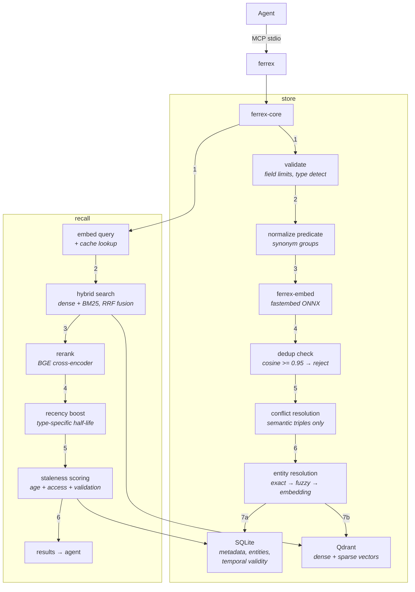

# ferrex

[](https://github.com/vaporif/ferrex/actions/workflows/ci.yml)
[](https://codecov.io/gh/vaporif/ferrex)

Local-first MCP memory server for AI agents. It is one Rust binary plus a Qdrant sidecar, with no cloud accounts.

Agents get persistent memory across conversations. Memories are typed, entities resolve even when agents spell them differently, and facts carry a validity window so old facts age out.

## Usage

Add to `~/.claude/settings.json`:

```json
{
  "mcpServers": {
    "ferrex": {
      "command": "uvx",
      "args": ["ferrex"]
    }
  }
}
```

If `ferrex` is on your PATH, use `"command": "ferrex"` and drop `args`.

<details>
<summary>Other ways to install</summary>

- Binary: [GitHub Releases](https://github.com/vaporif/ferrex/releases)
- Nix: `nix run github:vaporif/ferrex`
- From source: `cargo install --path crates/server`

</details>

## MCP tools

| Tool | What it does |
|------|--------------|
| `store` | Save a memory. The type is detected from the fields, or you can set it. |
| `recall` | Hybrid search (dense + BM25) with reranking, recency boost and staleness scores. |
| `forget` | Delete memories by ID. |
| `reflect` | Find stale memories and contradicting facts. |
| `stats` | Counts, staleness distribution and diagnostics. |

Each tool's parameters are described in its MCP schema.

## Memory types

| Type | Shape | Example | Half-life |
|------|-------|---------|-----------|
| Episodic | Free text | "Fixed a deadlock by switching to `tokio::sync::Semaphore`" | 30 days |
| Semantic | Subject, predicate, object | `api-server / uses / tokio 1.38` | 180 days |
| Procedural | Free text | A deployment checklist | 365 days |

When a new fact replaces an old one, the old fact is marked invalid instead of deleted, so the history stays.

## Shared daemon

The first session for a database starts a `ferrex` daemon. Later sessions connect to it through a small stdio proxy, so models and the database load once.

- The daemon exits after `FERREX_IDLE_TIMEOUT` seconds without sessions (default 600).
- Its log is `~/.ferrex/run/ferrexd.log`. `FERREX_RUN_DIR` moves the run directory.
- `--no-daemon`, `FERREX_NO_DAEMON=1` or a `:memory:` database serve MCP in-process.
- The Qdrant sidecar keeps running after the last session. `ferrex nuke` stops it, but only after it confirms the recorded PID is qdrant.
- `audit reconcile --fix`, `backfill` and `nuke` refuse to run while a daemon uses the database.

<details>
<summary>Architecture</summary>



| Crate | Role |
|-------|------|
| `ferrex-server` | MCP shell, CLI and shared daemon. |
| `ferrex-core` | The pipeline: validation, dedup, conflicts, entities, staleness, reranking. |
| `ferrex-embed` | Local ONNX embedding and reranking through fastembed. |
| `ferrex-store` | SQLite for metadata, Qdrant for vectors, and a journal for crash recovery. |

Entity resolution normalizes a name, then tries known aliases, Jaro-Winkler (> 0.85) and embedding similarity (cosine > 0.92) in that order. A match is saved as an alias. No match creates a new entity.

Predicates map to synonym groups, so "uses", "requires" and "imports" all become `depends_on`. Groups are set per namespace in `ferrex.toml`.

A new triple with the same subject and predicate as an existing one is compared by object. Similarity >= 0.95 is a duplicate and is rejected. Below 0.50 it replaces the old fact. Between those, pass `supersedes` yourself.

Episodic and procedural memories with cosine >= 0.95 to an existing memory in the namespace are rejected as duplicates.

Each recalled memory gets a staleness score from 0.0 (fresh) to 1.0 (stale). Decay is exponential with a half-life per type, and results are labeled fresh, aging or stale.

```
score = 0.40 * age_decay + 0.25 * access_decay + 0.25 * validation_decay + 0.10 * count_freshness
```

Recall runs dense and BM25 searches, merges them with reciprocal rank fusion and reranks with a BGE cross-encoder. Episodic memories get the strongest recency boost. Procedural memories get none.

</details>

## Configuration

Use CLI flags, environment variables or `~/.ferrex/ferrex.toml`.

<details>
<summary>Flags and environment variables</summary>

| Flag | Env var | Default | |
|------|---------|---------|-------------|
| `--qdrant-url` | `FERREX_QDRANT_URL` | | Remote Qdrant endpoint (skips the sidecar) |
| `--qdrant-bin` | `FERREX_QDRANT_BIN` | qdrant | qdrant binary for the sidecar |
| `--qdrant-port` | `FERREX_QDRANT_PORT` | 6334 | Sidecar gRPC port |
| `--model-tier` | `FERREX_MODEL_TIER` | best | `small` / `mid` / `best` |
| `--reranker-tier` | `FERREX_RERANKER_TIER` | default | `default` / `multilingual` |
| `--namespace` | `FERREX_NAMESPACE` | default | Default namespace |
| `--db-path` | `FERREX_DB_PATH` | ~/.ferrex/ferrex.db | SQLite path |
| `--config-path` | `FERREX_CONFIG_PATH` | ~/.ferrex/ferrex.toml | Config file |
| `--no-daemon` | `FERREX_NO_DAEMON` | off | Serve in-process |
| | `FERREX_IDLE_TIMEOUT` | 600 | Seconds before an idle daemon exits |
| | `FERREX_INIT_TIMEOUT` | 1800 | Seconds a daemon may spend starting |
| | `FERREX_RUN_DIR` | ~/.ferrex/run | Sockets, PID files and `ferrexd.log` |
| | `FERREX_LOG` | info | `tracing` env-filter, e.g. `ferrex_core=debug` |
| | `FERREX_LOG_FILE` | | Log to this file instead of stderr |
| | `FERREX_LOG_FORMAT` | text | `json` for structured logs |

| Model tier | Model | Dimensions |
|------------|-------|-----------|
| small | all-MiniLM-L6-v2 | 384 |
| mid | bge-small-en-v1.5 | 384 |
| best | bge-base-en-v1.5 | 768 |

</details>

Thresholds, predicate groups, staleness weights and cache sizes live in `ferrex.toml`. The first run writes it from [`crates/server/config/ferrex.toml`](crates/server/config/ferrex.toml), which lists every key. Unknown keys and invalid values fail at startup.

## CLI

```
ferrex                              # start MCP server (default)
ferrex audit reconcile [--fix] [--sample N] [--format text|json]  # detect/fix Qdrant<>SQLite mismatches
ferrex backfill normalized-predicates [--namespace NS] [--dry-run]  # populate missing normalized predicates
ferrex diagnose                     # print versions, Qdrant and SQLite health
ferrex journal show [--status pending|completed|failed] [--since 1h|24h|7d] [--limit N] [--format text|json]
ferrex nuke [--force]               # delete all data; stops the qdrant sidecar only on the default path (~/.ferrex)
```

## Design docs

- [Design doc](docs/design/ferrex-rag-memory.md): architecture, memory types, tool API, retrieval
- [Design decisions](docs/design/design-decisions.md)
- [References](docs/design/references.md)
- [Roadmap](docs/design/roadmap.md)
- [Future improvements](docs/design/future-improvements.md)

## License

MIT
